[English](README.md) | 日本語

# gs-modelflows

ローカル環境で完結する **3D Gaussian Splatting（3DGS）** アセット制作パイプラインと、**マルチエージェント対応スキル**（**Antigravity** / **Claude Code** / **OpenAI Codex** 互換）をまとめたリポジトリです。

1 枚の 2D リファレンス画像からクリーンなリグ付き 3DGS キャラクターを作成し、用途に応じて以下の 3 つのフローへ展開できます。

1. **3DGS モデリング＆リギング（`gs-modeling`）** — 単一画像からの 3DGS 生成（ComfyUI / TripoSplat）、正規化、シード比較、素体の整理、動的ドールアイ／まぶた（必須）、プロシージャルなリップシンク口（必須）、22 ボーンの Harmonic DQS リギング、Spark GPU による QA 動画生成。
2. **2D / HD-2D ゲームスプライト化（`gs-to-sprite`）** — 黒・白 2 パス差分マッティングによる完全透過、望遠・やや俯瞰の HD-2D カメラ、色付き 1px ピクセルアウトライン、チラつきのない統一パレット減色による多方向透過スプライトシート（`.png`）およびアニメーション `.gif` 出力。
3. **水密メッシュ＆一体 STL 出力（`gs-to-mesh`）** — 異方性 3D ガウシアン密度場の抽出、凹部保護ソリッド充填、Marching Cubes、Blender ボクセル結合（任意の円形ミニチュア台座付与）、エッジ保存バイラテラル法線ノイズ除去、非多様体・底面 `Z=0`・FDM 薄肉自動監査、多方向クレイ比較 QA。

---

## ショーケース：1 枚の 2D 画像 → リグ付き 3DGS → 8 方向 HD-2D スプライト

**正面の 2D キャラクター画像 1 枚**から、`gs-modeling` で動的まばたき・視線・口パク＆マント破れ防止 Harmonic DQS リグ付きの 3DGS モデルを構築し、そのまま `gs-to-sprite` へ渡して多方向で絵柄が一貫した HD-2D ゲームスプライト＆透過 GIF を出力する一連の作例です。

| 1. 入力（2D デザイン画 1 枚） | 2. リグ付き 3DGS（`gs-modeling`・360° 8 方向） |
| :---: | :---: |
| 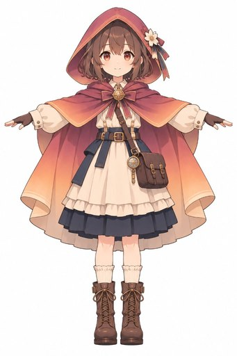 | 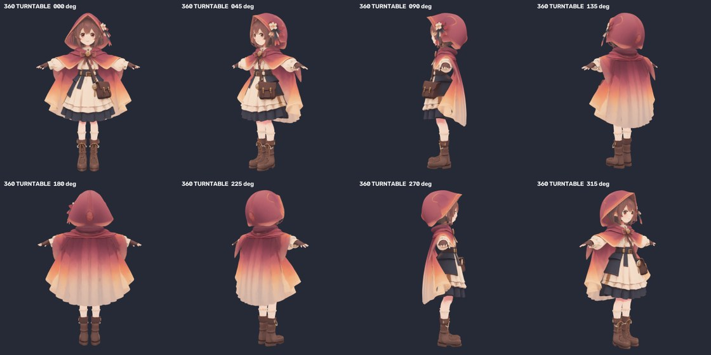 |

### 表情・リグ・全身モーション QA（`gs-modeling`）
瞬き・ウインク・視線追従・首振り ±18°・あいうえお口パク・腕上げ／手振り・歩行／走行／ジャンプを Spark GPU で約 12 秒で一括レンダリング：

<p align="center">
  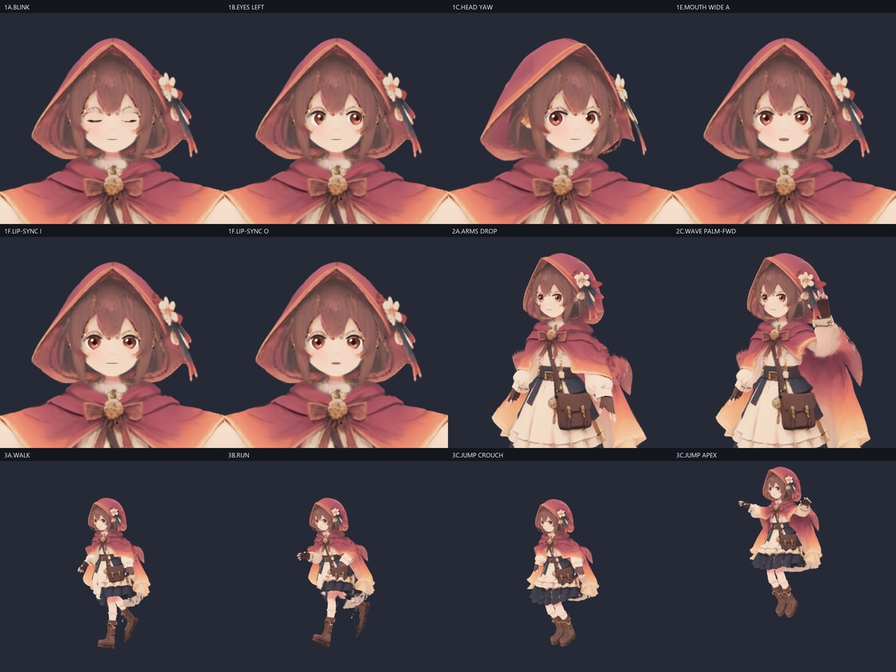
</p>

### 8 方向 HD-2D ゲームスプライト ＆ アニメーション GIF（`gs-to-sprite`）
リグ済み `anim.json` から黒白 2 パス完全透過マッティング・暖色ダーク 1px 縁取り・統一パレット減色で直接出力（`80×80 px`・48 色・`pitch 14°` 望遠俯瞰カメラ）：

| 8 方向円周てくてく歩行 GIF（HD-2D 80px・3 倍拡大） | HD-2D ジオラマ背景プレビュー（`--scene-preview`） |
| :---: | :---: |
| 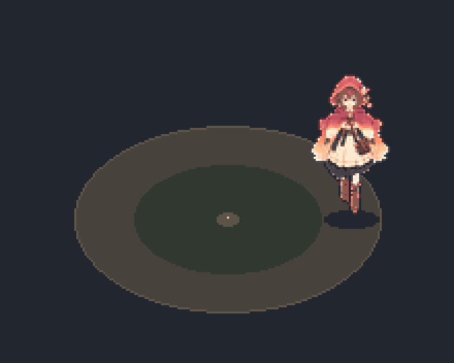 | 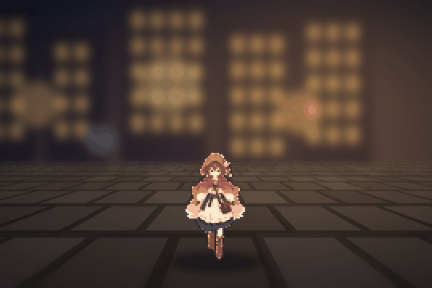 |

<details>
<summary>8 方向 × 8 フレーム透過スプライトシート全体を見る（<code>spritesheet_80px.png</code>）</summary>
<p align="center">
  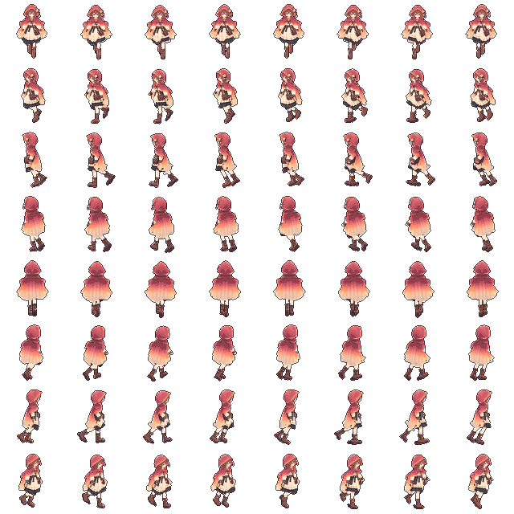
</p>
</details>

### 深度マップ ＆ 法線マップによる 2D リアルタイム光源（`--export-maps`）
`--export-maps` を指定すると、通常スプライトと **1 ピクセルもズレないカメラ空間深度マップ＆ビュー空間法線マップ** を同時出力します。ゲーム側では 2D スプライト 3 枚だけで、焚き火や手持ちランタンによるリアルタイム 3D 陰影・逆光リムライト・落ち影・背景プロップとの 2.5D 前後ソートがそのまま動きます：

<p align="center">
  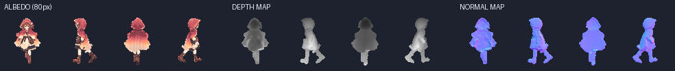
</p>

| 夜の焚き火リアルタイム光源（8 方向・2D マップのみ） | ランタン探索デモ（3DGS 背景オブジェクト＋宝箱観察） |
| :---: | :---: |
| 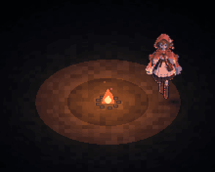 | 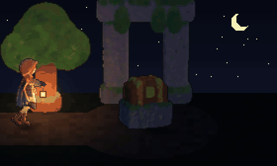 |

### フィギュア向けポージング ＆ 3D プリント用水密メッシュ（`gs-to-mesh`）
同じ Harmonic DQS スケルトンを使って任意の立ちポーズ＋3DGS 小物（ランタン掲げ・首傾げ・自然なスタンス広げ・両足 `Z=0` 接地）を付け、**異方性ガウシアン密度場 → 凹部保護ソリッド充填 → Blender 32 mm 台座結合 → エッジ保存バイラテラル法線ノイズ除去 → FDM 薄肉自動監査**を通して、**1 連結・非多様体エッジ 0 の 3D プリント用 `.stl` / `.glb`** へ変換します：

<p align="center">
  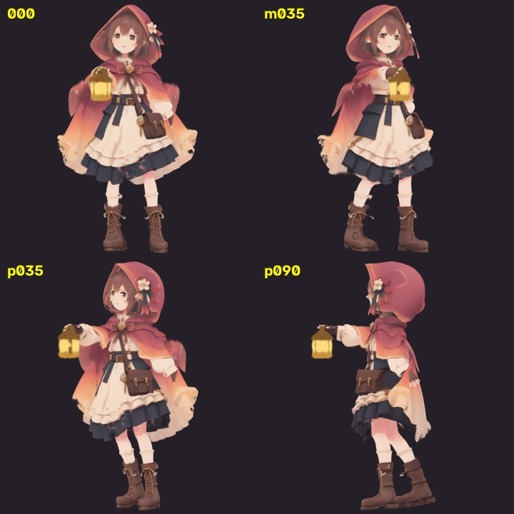
</p>

<p align="center">
  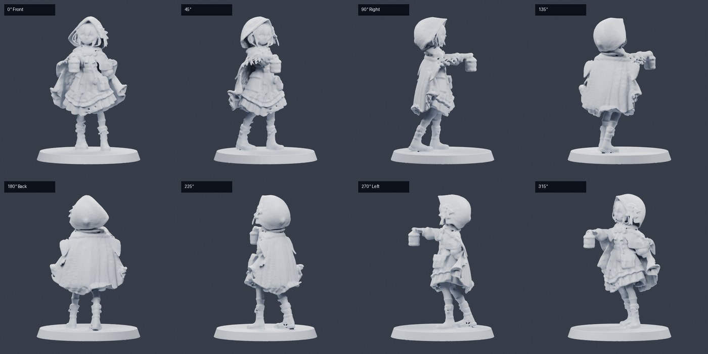
</p>

- **出力検証結果（`hood01_lantern_32mm_fdm.stl`）**: `nonmanifold_edges = 0` · `components = 1` · `min_z = 0.0 mm` · 外寸 `32.0 × 31.9 × 44.2 mm` · FDM `0.4 mm` ノズル肉厚監査（`p05 = 0.45 mm` / 中央値 `1.47 mm` / 1 ノズル未満 `2.8%`）

### 1 枚のプロップシート → 32 点一括 3DGS 量産（`gs-modeling` `mode: static_prop`）
黒背景・白背景・透過背景に複数の小道具を並べた 1 枚絵から、`batch_static_props.py` で**隣のプロップ混入なしの自動マスク分割 → ComfyUI / TripoSplat 連続生成（8GB VRAM 向け自動監視＆予防再起動つき）→ 正立 Z-up・実寸スケール・底面 `Z=0` ピボット・`meta.json` 付き `v1_prop/` 一括凍結 → Spark 3DGS 一覧コンタクトシート出力**まで一気に量産できます：

<p align="center">
  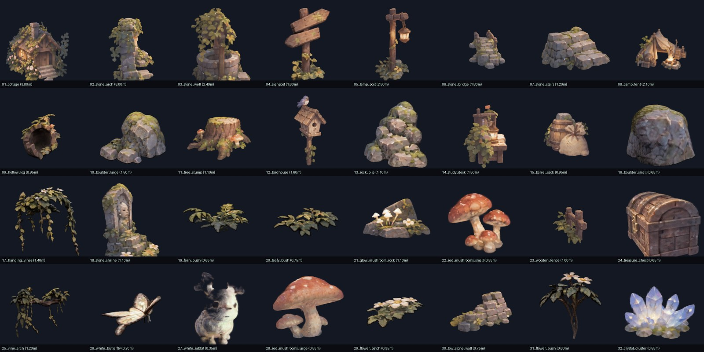
</p>

### エージェントへの指示例（使い方イメージ）
**Antigravity** / **Claude Code** / **Codex** にスキルを導入した状態で、2D 画像を添付して自然言語で依頼するだけで実行できます：

- **1 枚の画像からリグ付き 3DGS キャラを作る（`gs-modeling`）**:
  > *「このデザイン画から `gs-modeling` でリグ付き 3DGS キャラを作って。動的アイ・口パク・QA 動画まで確認して」*
- **8 方向 HD-2D 歩行スプライト＆ GIF を出す（`gs-to-sprite`）**:
  > *「`gs-to-sprite` で 8 方向の 80px・48 色の HD-2D 歩行スプライトと、`--scene-preview` 付きの GIF を作って」*
- **ポーズを付けて 3D プリント用 STL を作る（`gs-to-mesh`）**:
  > *「ランタンを掲げて周囲を見渡すフィギュアポーズを付けて、`gs-to-mesh` で 32mm 台座付きの FDM 向け水密 STL（`--opening 1 --fdm-nozzle-mm 0.4`）と 8 方向クレイ QA を出力して」*
- **画質・テイストの出し分け例**:
  - レトロ RPG 風：`--size 64 --colors 32 --num-frames 4`
  - クラシック HD-2D 風：`--size 80 --colors 48 --pitch 14 --fov 11 --scene-preview`
  - 高精細 ARPG / アクション風：`--size 160 --colors 128 --pitch 0 --no-outline`
- **今後のモーション拡張（Kimodo 等との連携）**: `v1/rig_skeleton.json` → `anim.json` → `gs-to-sprite` が疎結合に分離されているため、Kimodo などのモーション生成モデルや BVH/SMPL リターゲットを挟むだけで、攻撃・詠唱・待機・ダンス等の 8 方向 HD-2D スプライトをキャラの絵柄を崩さず自動量産できます。

---

## Architecture

```text
gs-modelflows/
├── AGENTS.md                   # Codex / 汎用エージェント向け指示書
├── CLAUDE.md                   # Claude Code 向け指示書
├── install_skills.py           # リポジトリ内スキル同期 & Antigravity / Claude / Codex へのグローバル配置
├── shared/                     # 共通 Python コア（PLY I/O, Harmonic DQS, プロシージャル口, 設定ローダー）
├── renderer/spark_demo/        # ヘッドレス three.js + Spark GPU SplatSkinning レンダラー
├── skills/                     # スキル本体（Single Source of Truth）
│   ├── gs-modeling/
│   ├── gs-to-sprite/
│   └── gs-to-mesh/
├── .agents/skills/             # Codex / Agent Skills 対応ホストによる自動検出用
├── .claude/skills/             # Claude Code による自動検出用
└── .agent/skills/              # Antigravity による自動検出用
```

---

## Quick Start

### 1. Python・レンダラーのセットアップ

手順の詳細は [docs/SETUP.ja.md](docs/SETUP.ja.md)（英語版: [docs/SETUP.md](docs/SETUP.md)）を参照してください（任意のローカル ComfyUI + TripoSplat の導入手順も含みます）。

```bash
pip install -e ".[all]"
cd renderer/spark_demo && npm install && npm run sync-vendor
cd ../..
python check_env.py
```

任意の環境変数（利用可能な場合は既定値で自動検出されます）：

| 環境変数 | 用途 | 既定値 |
| :--- | :--- | :--- |
| `GS_COMFYUI_DIR` | ローカル ComfyUI リポジトリのルート（`_splat_density` 高速化用） | *（未設定時は PyTorch フォールバックを使用）* |
| `GS_COMFYUI_URL` | ローカル ComfyUI の API エンドポイント | `http://127.0.0.1:8188` |
| `GS_BLENDER_BIN` | Blender CLI 実行ファイルのパス（`>= 4.2` / `5.x`） | `blender` |
| `GS_SPARK_DIR` | `renderer/spark_demo` のパス（グローバルスキル利用時に推奨） | 自動検出 |
| `SPARK_CHROME` | ヘッドレス WebGL 用 Chrome / Chromium 実行ファイルのパス | 自動検出 |
| `SPARK_SOFTWARE` | `1` を指定すると SwiftShader によるソフトウェア WebGL を強制 | `0` |

> **プラットフォームと言語に関する補足**:
> - 主に **Windows 11（NVIDIA GPU）** で動作確認しています。macOS / Linux でもクロスプラットフォーム向け WebGL フラグで動作します（`SPARK_SOFTWARE=1` のフォールバックも利用可能）。
> - トップレベルのドキュメントは英語（`README.md`, `AGENTS.md`, `docs/SETUP.md`）と日本語（`README.ja.md`, `docs/SETUP.ja.md`）の両方を用意しており、各 `SKILL.md` の詳細手順は日本語で記述されています（対応する各コーディングエージェントからそのまま読み込めます）。

### 2. Antigravity / Claude Code / Codex での利用

- **プロジェクト単位で利用（設定不要）**: `git clone` して Antigravity / Claude Code / Codex で `gs-modelflows` を開くだけで、`.agent/skills/`・`.claude/skills/`・`.agents/skills/` が自動的に認識されます。
- **グローバルにインストール（別ワークスペースからも利用）**:

```bash
# Install all 3 skills for all supported agents
python install_skills.py --target all

# Or target a specific agent
python install_skills.py --target claude
python install_skills.py --target codex
python install_skills.py --target antigravity
```

---

## 3 つのフロー概要

### Flow 1: `gs-modeling`（画像 → リグ付き 3DGS）
- クリーンな透過入力画像の準備（`step0_prep_image.py`, `gate0_check_input.py`）
- 3DGS `.ply` の生成と正規化（`step0_generate_ply.py`, `step1_normalize.py`）
- スケルトン合わせ、眼窩くり抜き、動的眼球・まぶた＆プロシージャル口の構築（`step2_fit_skeleton.py` .. `step5_merge_ply.py`）
- `v1/` パッケージ凍結＆ GPU スキニング QA 動画レンダリング（`step7_build_v1_package.py`, `render_standard_qa_video.py`, `verify_gate.py`）

### Flow 2: `gs-to-sprite`（3DGS → 2D / HD-2D スプライト＆ GIF）
```bash
python skills/gs-to-sprite/scripts/render_hd2d_sprites.py \
  --anim-json path/to/anim.json \
  --out-dir work/my-char/sprites \
  --size 160 \
  --directions front:0,diag:40,side:90,back:180 \
  --scene-preview
```
- 任意のスプライト解像度に対応（`64`, `80`, `128`, `160`, `224` など）
- 黒・白 2 パス（`#000000` / `#ffffff`）の差分マッティングで 3DGS 特有のエッジのフリンジを完全に除去
- 明部を優先した統一パレット減色により、フレーム間の色チラつきを防止

### Flow 3: `gs-to-mesh`（3DGS → 密度場メッシュ → 水密 STL / GLB）
```bash
# 1. Extract watertight surface mesh from 3DGS Gaussian density field
python skills/gs-to-mesh/scripts/extract_density_mesh.py \
  --ply work/my-char/posed.ply \
  --out work/my-char/body_mesh.npz \
  --threshold 0.33 --closing 2 --grid-res 380

# 2. Voxel union + optional miniature base + manifold check + STL/GLB export + 6-view QA
blender -b --python skills/gs-to-mesh/scripts/assemble_watertight_stl.py -- \
  --body-npz work/my-char/body_mesh.npz \
  --out-stl work/my-char/model_25p4mm.stl \
  --add-base --base-diameter-mm 25.4 \
  --render-qa-dir work/my-char/qa_mesh
```

---

## License

MIT License — 詳細は [LICENSE](LICENSE) を参照してください。

> **サードパーティ製モデル・ツールについて**: 任意のワークフローから参照する外部モデルおよびツール（TripoSplat、BiRefNet、ComfyUI、Blender、three.js、`@sparkjsdev/spark` など）は本リポジトリには同梱されておらず、それぞれのライセンスに従います。
