English | [日本語](README.ja.md)

# gs-modelflows

Modular local **3D Gaussian Splatting (3DGS)** asset pipelines and **multi-agent skills** (compatible with **Antigravity**, **Claude Code**, and **OpenAI Codex**).

Start from a single 2D reference image, build a clean rigged 3DGS character, and branch into:
1. **3DGS Modeling & Rigging (`gs-modeling`)** — Single-image 3DGS generation (ComfyUI / TripoSplat), normalization, multi-seed comparison, body cleanup, mandatory dynamic doll eyes/eyelids and procedural lip-sync mouth, 22-bone Harmonic DQS rigging, and Spark GPU QA videos.
2. **2D / HD-2D Game Sprites (`gs-to-sprite`)** — Multi-angle transparent sprite sheets (`.png`) and animated `.gif` exports with dual-background exact alpha matting, telephoto/top-down framing, tinted 1px pixel outlines, and unified flicker-free palettes.
3. **Watertight Mesh & Unified STL (`gs-to-mesh`)** — Anisotropic 3D Gaussian density extraction, concave-safe solid filling, marching cubes, Blender voxel union (with optional circular miniature base), edge-preserving bilateral normal denoising, manifold/`Z=0` + FDM wall-thickness audit, and multi-view clay QA.

---

## Showcase: Single 2D Image → Rigged 3DGS → 8-Direction HD-2D Sprites

Starting from **one front-facing 2D character image**, the agent runs `gs-modeling` end-to-end to build a rigged 3DGS character with dynamic blink/gaze/lip-sync and cape-safe Harmonic DQS skinning, then hands off directly to `gs-to-sprite` to export consistent 8-direction HD-2D game sprites and animated GIFs.

| 1. Input (Single 2D Image) | 2. Rigged 3DGS (`gs-modeling`, 360° 8-View) |
| :---: | :---: |
| 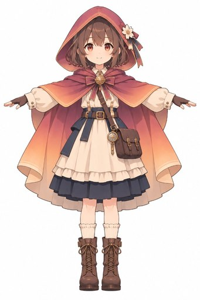 | 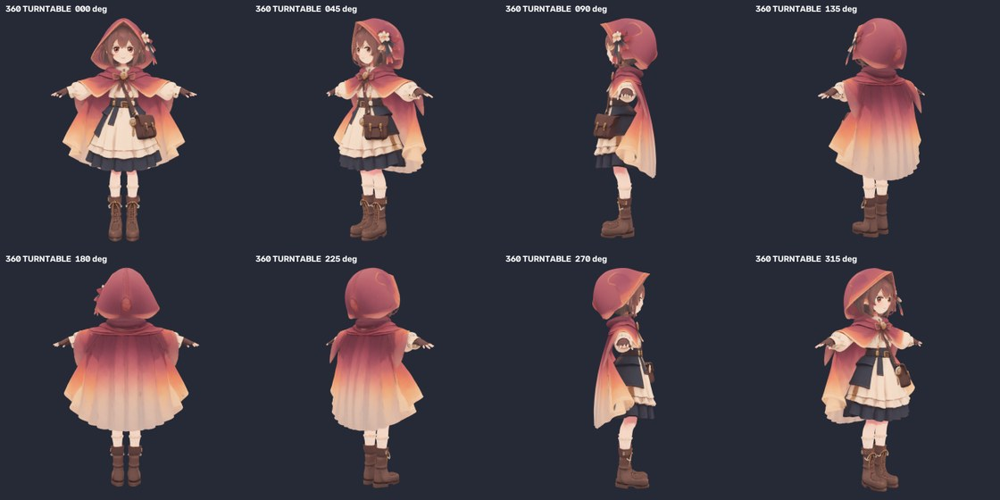 |

### Facial Expressions, Rigging & Motion QA (`gs-modeling`)
Blink, wink, binocular gaze tracking, ±18° head turn, A-I-U-E-O lip-sync, arm raise/wave, and full-body walk/run/jump rendered in ~12 seconds on Spark GPU:

<p align="center">
  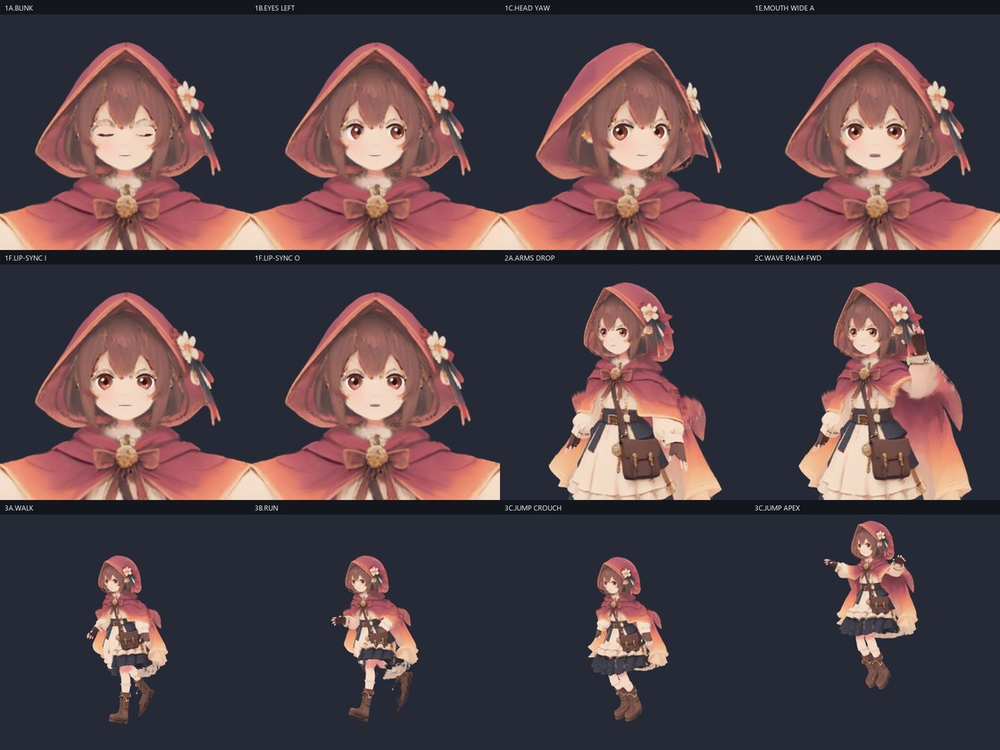
</p>

### 8-Direction HD-2D Game Sprites & Animated GIFs (`gs-to-sprite`)
Exported directly from the rigged `anim.json` with black/white dual-pass exact alpha matting, warm tinted 1px pixel outlines, and unified flicker-free palettes (`80×80 px`, 48 colors, `pitch 14°` top-down telephoto camera):

| 8-Direction Circular Walk (HD-2D 80px, 3×) | HD-2D Diorama Preview (`--scene-preview`) |
| :---: | :---: |
| 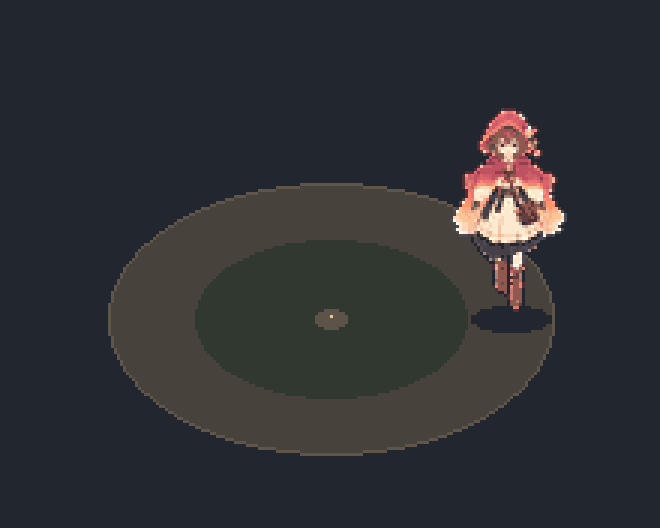 | 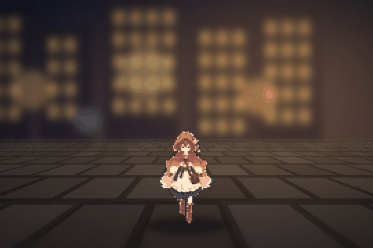 |

<details>
<summary>View full 8-direction × 8-frame transparent sprite sheet (<code>spritesheet_80px.png</code>)</summary>
<p align="center">
  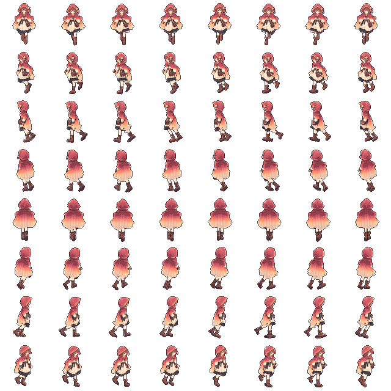
</p>
</details>

### Real-Time 2D Lighting with Depth & Normal Maps (`--export-maps`)
Adding `--export-maps` exports pixel-aligned **camera-space depth** and **view-space normal** sprite sheets alongside the albedo sheet — enabling real-time 2D point lights, warm rim lighting, dynamic ground shadows, and 2.5D depth sorting with background props (all shaded purely from 2D sprites!):

<p align="center">
  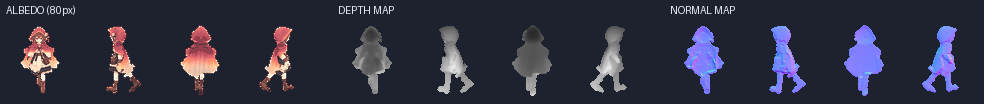
</p>

| Campfire Relighting (8-Dir Walk, Albedo+Depth+Normal) | Lantern Exploration with 3DGS Background Props |
| :---: | :---: |
| 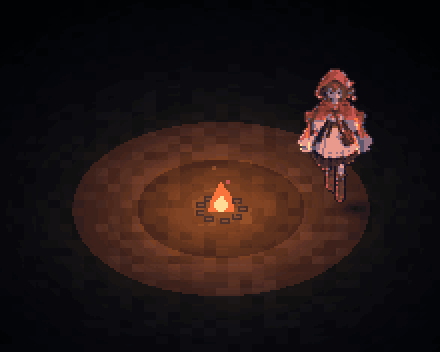 | 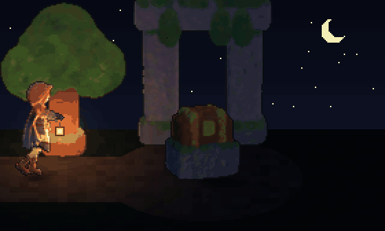 |

### Hero Posing & 3D-Printable Watertight Mesh (`gs-to-mesh`)
Using the same Harmonic DQS skeleton, you can pose the character with custom 3DGS props (e.g., raised vintage lantern, curious head tilt, widened natural figure stance with boots grounded at `Z = 0`) and export a **single-component, watertight, FDM-ready `.stl` / `.glb`** via anisotropic Gaussian density extraction, concave-safe solid filling, edge-preserving **bilateral normal denoising**, and automatic BVHTree wall-thickness audit:

<p align="center">
  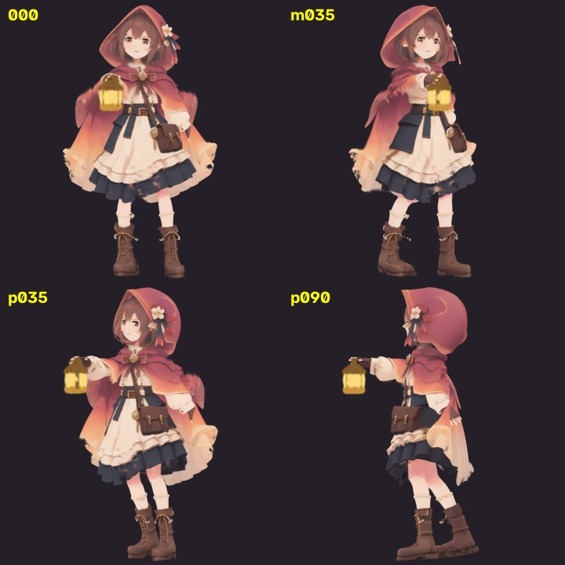
</p>

<p align="center">
  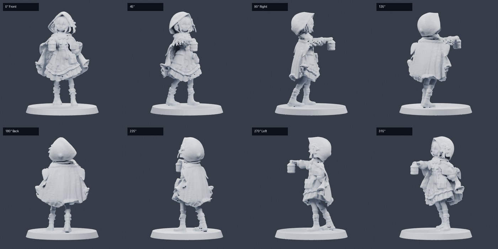
</p>

- **Verified Print Output (`hood01_lantern_32mm_fdm.stl`)**: `nonmanifold_edges = 0` · `components = 1` · `min_z = 0.0 mm` · `32.0 × 31.9 × 44.2 mm` · FDM `0.4 mm` nozzle audit (`p05 = 0.45 mm`, `median = 1.47 mm`, `< 1 nozzle = 2.8%`).

### Batch Prop-Sheet → 32 Static 3DGS Assets (`gs-modeling`, `mode: static_prop`)
Given a single multi-object prop sheet (black, white, or transparent background), `batch_static_props.py` auto-segments every non-overlapping prop with neighbor-free masks, runs resumable ComfyUI / TripoSplat batch generation (with proactive process recycling for 8 GB GPUs), converts each to upright Blender Z-up with real-world height scaling, `Z = 0` bottom-center pivot, and `meta.json` (`v1_prop/`), and renders an upright 3DGS contact sheet:

<p align="center">
  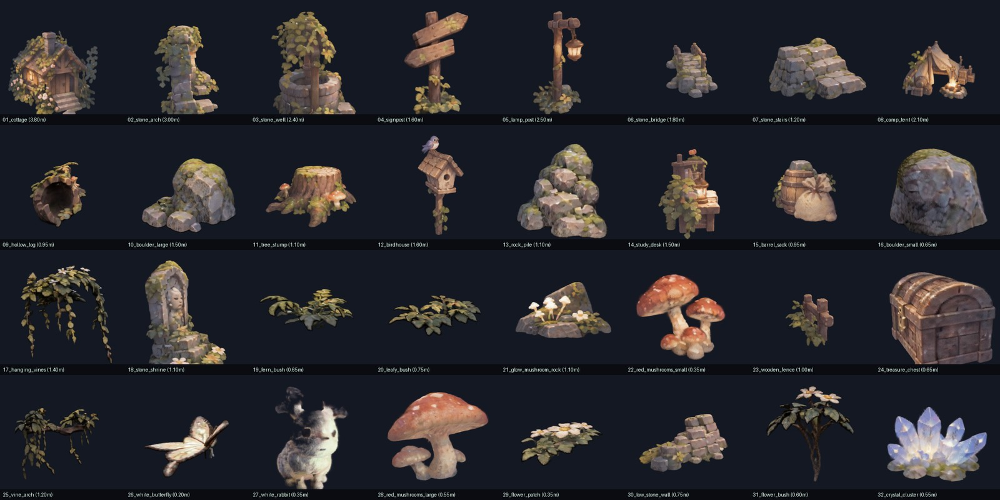
</p>

### Example Agent Prompts (How to Use)
Once installed in **Antigravity**, **Claude Code**, or **Codex**, just attach a 2D character image and ask naturally:

- **Build a rigged 3DGS character (`gs-modeling`)**:
  > *"Create a rigged 3DGS character from this image using `gs-modeling`, including dynamic eyes, lip-sync mouth, and a QA video."*
- **Export HD-2D walking sprites (`gs-to-sprite`)**:
  > *"Using `gs-to-sprite`, generate an 8-direction 80px HD-2D walking sprite sheet (48 colors, `pitch 14°`) with `--scene-preview` and an animated GIF."*
- **Pose and export a 3D-printable STL (`gs-to-mesh`)**:
  > *"Pose the character holding a lantern in a natural figure stance, then convert it with `gs-to-mesh` into a watertight 32mm-base STL (`--opening 1 --fdm-nozzle-mm 0.4`) with 8-view clay QA."*
- **Customize sprite style on the fly**:
  - Retro RPG: `--size 64 --colors 32 --num-frames 4`
  - Classic HD-2D: `--size 80 --colors 48 --pitch 14 --fov 11 --scene-preview`
  - High-res ARPG / Action: `--size 160 --colors 128 --pitch 0 --no-outline`
- **Future motion retargeting**: Because the pipeline cleanly separates `v1/rig_skeleton.json` → `anim.json` → `gs-to-sprite`, external motion generators (such as Kimodo or BVH/SMPL retargeting) can drive the 21-bone rig to batch-produce arbitrary 8-direction attack, spellcast, idle, or dance sprites with 100% character consistency.

---

## Architecture

```text
gs-modelflows/
├── AGENTS.md                   # Codex / generic agent instructions
├── CLAUDE.md                   # Claude Code instructions
├── install_skills.py           # Sync repo skill dirs & install globally for Antigravity / Claude / Codex
├── shared/                     # Core Python modules (PLY I/O, Harmonic DQS, procedural mouth, config)
├── renderer/spark_demo/        # Headless three.js + Spark GPU SplatSkinning renderer
├── skills/                     # Canonical skill sources (Single Source of Truth)
│   ├── gs-modeling/
│   ├── gs-to-sprite/
│   └── gs-to-mesh/
├── .agents/skills/             # Auto-discovered by Codex / Agent Skills hosts
├── .claude/skills/             # Auto-discovered by Claude Code
└── .agent/skills/              # Auto-discovered by Antigravity
```

---

## Quick Start

### 1. Python & Renderer Setup

See [docs/SETUP.md](docs/SETUP.md) for the complete step-by-step setup (including optional local ComfyUI + TripoSplat).

```bash
pip install -e ".[all]"
cd renderer/spark_demo && npm install && npm run sync-vendor
cd ../..
python check_env.py
```

Optional environment variables (defaults auto-detect when available):

| Variable | Purpose | Default |
| :--- | :--- | :--- |
| `GS_COMFYUI_DIR` | Local ComfyUI repository root (for `_splat_density` acceleration) | *(unset — uses PyTorch fallback)* |
| `GS_COMFYUI_URL` | Local ComfyUI API endpoint | `http://127.0.0.1:8188` |
| `GS_BLENDER_BIN` | Path to Blender CLI executable (`>= 4.2` / `5.x`) | `blender` |
| `GS_SPARK_DIR` | Path to `renderer/spark_demo` (recommended when using global skills) | auto-detected |
| `SPARK_CHROME` | Path to Chrome/Chromium executable for headless WebGL | auto-detected |
| `SPARK_SOFTWARE` | Set to `1` to force SwiftShader software WebGL | `0` |

> **Platform & Language Notes**:
> - Verified primarily on **Windows 11 (NVIDIA GPU)**; macOS and Linux are supported via cross-platform WebGL flags (`SPARK_SOFTWARE=1` fallback available).
> - Top-level docs (`README.md`, `AGENTS.md`, `docs/SETUP.md`) are in English; detailed `SKILL.md` workflow guides are currently written in Japanese (readable by all supported coding agents).

### 2. Using with Antigravity, Claude Code, or Codex

- **Project-local (zero setup)**: Just `git clone` and open `gs-modelflows` in Antigravity, Claude Code, or Codex — the `.agent/skills/`, `.claude/skills/`, and `.agents/skills/` directories are discovered automatically.
- **Global install (use from any workspace)**:

```bash
# Install all 3 skills for all supported agents
python install_skills.py --target all

# Or target a specific agent
python install_skills.py --target claude
python install_skills.py --target codex
python install_skills.py --target antigravity
```

---

## The Three Flows at a Glance

### Flow 1: `gs-modeling` (Image → Rigged 3DGS)
- Prepare clean alpha input (`step0_prep_image.py`, `gate0_check_input.py`)
- Generate & normalize 3DGS `.ply` (`step0_generate_ply.py`, `step1_normalize.py`)
- Fit skeleton, carve eye sockets, build dynamic eyeballs/eyelids & procedural mouth (`step2_fit_skeleton.py` .. `step5_merge_ply.py`)
- Freeze `v1/` package & render GPU-skinned QA video (`step7_build_v1_package.py`, `render_standard_qa_video.py`, `verify_gate.py`)

### Flow 2: `gs-to-sprite` (3DGS → 2D / HD-2D Sprites & GIFs)
```bash
python skills/gs-to-sprite/scripts/render_hd2d_sprites.py \
  --anim-json path/to/anim.json \
  --out-dir work/my-char/sprites \
  --size 160 \
  --directions front:0,diag:40,side:90,back:180 \
  --scene-preview
```
- Supports arbitrary sprite resolutions (`64`, `80`, `128`, `160`, `224`, etc.)
- Dual-background (`#000000` / `#ffffff`) difference matting removes 3DGS edge fringe completely
- Unified palette quantization with highlight preservation prevents frame-to-frame flicker

### Flow 3: `gs-to-mesh` (3DGS → Density Mesh → Watertight STL / GLB)
```bash
# 1. Extract watertight surface mesh from 3DGS Gaussian density field
python skills/gs-to-mesh/scripts/extract_density_mesh.py \
  --ply work/my-char/posed.ply \
  --out work/my-char/body_mesh.npz \
  --threshold 0.33 --closing 2 --grid-res 380

# 2. Voxel union + optional miniature base + manifold check + STL/GLB export + 6-view QA
blender -b --python skills/gs-to-mesh/scripts/assemble_watertight_stl.py -- \
  --body-npz work/my-char/body_mesh.npz \
  --out-stl work/my-char/model_25p4mm.stl \
  --add-base --base-diameter-mm 25.4 \
  --render-qa-dir work/my-char/qa_mesh
```

---

## License

MIT License — see [LICENSE](LICENSE).

> **Third-party models & tools**: External models and tools referenced by optional workflows (such as TripoSplat, BiRefNet, ComfyUI, Blender, three.js, and `@sparkjsdev/spark`) are **not** bundled in this repository and remain subject to their respective licenses.
